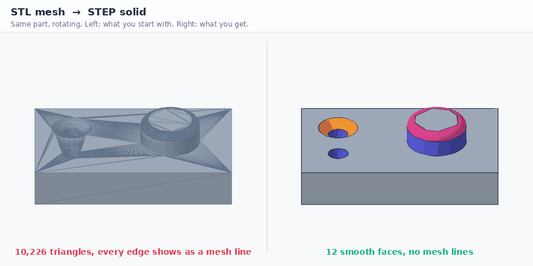
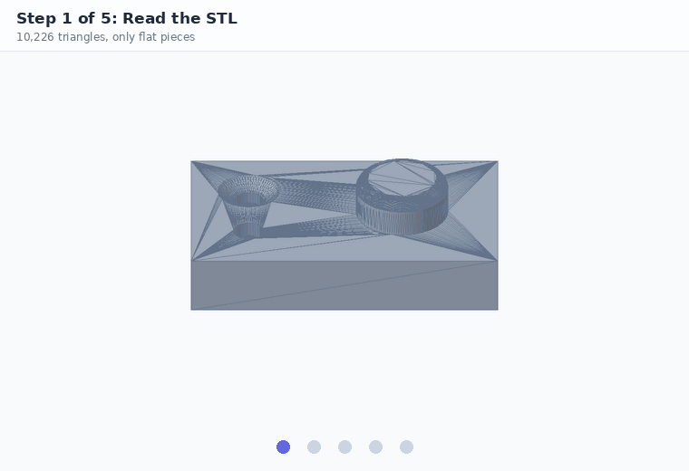
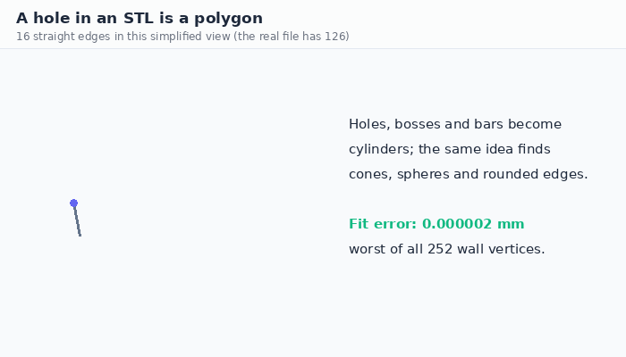
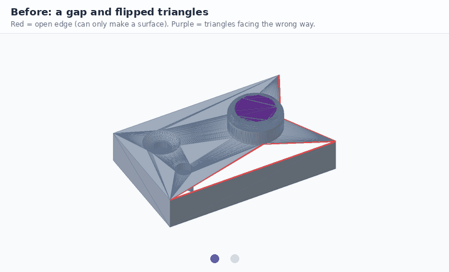
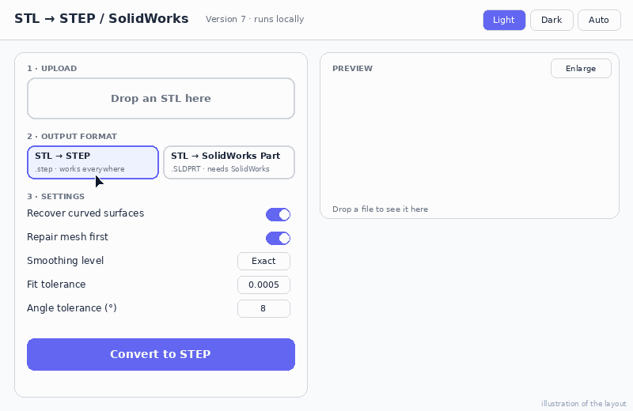

# STL → STEP converter

**Turn STL meshes into STEP solids with real curved surfaces, not piles of triangles.**

<p align="center">
  
</p>
<p align="center"><sub>Real output on <code>examples/sample_part.stl</code>: 10,226 triangles become 12 faces.</sub></p>


An STL file is only triangles, so a round hole is a many-sided polygon and a CAD program shows every edge as a mesh line.
This tool finds the **holes, bosses, round bars, cones, domes and rounded edges** in the mesh and rebuilds them as true
curved CAD surfaces with exact circular edges. It repairs small mesh problems first so you get a **solid**, and it comes with a
local **web dashboard**. On Windows with SolidWorks it can also save a `.SLDPRT`.

> **Heads-up:** freeform / organic surfaces (sculpted shapes, scans) are **not** smoothed. They stay as flat triangles,
> because that needs NURBS fitting. See [Limitations](#limitations).

**Jump to:** [Quick start](#quick-start) · [How it works](#how-it-works) · [Mesh repair](#mesh-repair) ·
[Dashboard](#the-dashboard) · [Options](#command-line-options) · [SolidWorks](#solidworks-sldprt) ·
[Cloud / GitHub](#run-it-from-anywhere) · [Results](#results) · [Limitations](#limitations) · [Troubleshooting](#troubleshooting)

---

## Quick start

<p align="center">
  
</p>
<p align="center"><sub>Terminal drawing; the converter log shown is real output.</sub></p>

You need **Python 3.9 to 3.12** (tested on 3.12; the Docker, Codespaces and Actions setups use 3.11).

```bash
git clone https://github.com/YOUR-NAME/stl-to-step.git
cd stl-to-step
pip install -r requirements.txt

python stl2step.py examples/sample_part.stl     # try the included sample, writes examples/sample_part.step
python dashboard.py                             # or open the dashboard: http://localhost:8000
```

On Windows you can double-click **`start_dashboard.bat`**: it checks Python, installs the libraries and starts the dashboard.

More ways to run it:

```bash
python stl2step.py part.stl                  # writes part.step next to it
python stl2step.py *.stl -o out_folder       # batch
python stl2step.py part.scad                 # OpenSCAD file (needs OpenSCAD installed)
```

`requirements.txt` installs `numpy`, `cadquery-ocp` (OpenCascade for Python) and, on Windows only, `pywin32` (only for the SolidWorks option).
Without numpy / cadquery-ocp the script still runs in a basic pure-Python mode that merges flat areas but leaves curves as triangles.

---

## How it works

<p align="center">
  
</p>
<p align="center"><sub>Each frame is rendered from the converter's real output on the sample part.</sub></p>

1. **Read** the STL (binary or ASCII) and weld duplicate vertices.
2. **Repair** the mesh: consistent triangle orientation and closed gaps (next section).
3. **Find curved surfaces.** A systematic search with robust fitting finds cylinders first, then rounded edges
   (tori around those cylinders' axes), cones and spheres. Each candidate grows over the mesh while the triangles stay within
   tolerance, and borders between tangent surfaces are cleaned up.
4. **Merge flat triangles** into planar faces.
5. **Rebuild exact edges:** straight lines and true circles (short polylines only where neither fits).
6. **Build the solid** with OpenCascade: faces on the fitted surfaces, checked for validity and area, then sewn together.
7. **Verify** the volume against the mesh and write the STEP. If a face cannot be built exactly, only that face falls back to flat facets.

### Why holes come out round

<p align="center">
  
</p>
<p align="center"><sub>Simplified to 16 vertices for the drawing; the fit uses all the real vertices of the sample's hole.</sub></p>

The mesh vertices of a hole all lie on one circle, so a least-squares fit recovers the exact radius and the polygon becomes a single circular edge.
The same idea, with different surface types, finds cones, spheres and rounded edges.

---

## Mesh repair

<p align="center">
  
</p>
<p align="center"><sub>Damage added to the sample on purpose, repaired by the real <code>repair_tris</code> function.</sub></p>

A STEP **solid** needs a closed mesh with every triangle facing outward. Repair runs by default and:

- turns **flipped triangles** back the right way,
- closes **gaps** (ear clipping, with a fan fallback),
- flips the whole mesh if it was inside out.

Without it, a mesh with a gap can only become a *surface*. Repair is meant for **small gaps**. It fills every opening it finds, so
if a whole face is missing, any through-holes in that face get capped too. Turn it off with `--no-repair`.

---

## The dashboard

<p align="center">
  
</p>
<p align="center"><sub>Drawn illustration of the layout (simplified), not a screen recording.</sub></p>

`python dashboard.py` starts a local web page. Everything runs on your computer; results are saved in `dashboard_output/`.

1. **Upload:** drop an STL on the page.
2. **Output format:** *STL → STEP* or *STL → SolidWorks Part (.SLDPRT)*. If the dashboard runs where SolidWorks is not available (cloud, Linux), it offers the [SolidWorks bridge](#hosted-dashboard-codespaces-docker-cloud-the-solidworks-bridge) instead.
3. **Settings:** recover curved surfaces, repair mesh first, smoothing level, fit tolerance, angle tolerance, minimum triangles.
4. **Convert,** then read the result: triangles in, faces out, curved surfaces found, **Faceted area**, **Volume match**, a face-type bar, the log and download buttons.
   Earlier conversions stay in **History**.

**Preview:** drag to rotate. Click **Enlarge** (or double-click the preview) for a big view that **auto-rotates**; Esc or a click outside closes it.
Auto-rotate has a checkbox, and starts off if your system asks for reduced motion. Themes: **Light / Dark / Auto**.

**Faceted area** is the share of the surface still made of small flat faces. Under 1% means almost no mesh lines will show in CAD.

<details>
<summary><b>Settings explained</b></summary>

| Setting | Default | What it does |
|---|---|---|
| Smoothing level | Exact | Presets for the two values below. Higher merges more small triangles into bigger faces: fewer mesh lines, slightly less exact. |
| Fit tolerance | `0.0005` | Fraction of the part size a surface may deviate. Raise it for noisy or scanned meshes. |
| Angle tolerance | `8°` | Largest surface-normal error allowed for a curved fit. |
| Min triangles | `10` | Smallest group of triangles that may become a curved surface. |
| Repair mesh first | on | Fixes flipped triangles and closes gaps. |

</details>

---

## Command line options

```text
python stl2step.py INPUT [INPUT ...] [options]

  -o, --out FOLDER      output folder (default: next to each input)
  --sldprt              also save a SolidWorks .SLDPRT (Windows + SolidWorks + pywin32)
  --no-curves           skip curved-surface recovery (flat merged faces only)
  --tol FRACTION        fit tolerance as a fraction of part size   (default 0.0005)
  --ang DEGREES         normal tolerance for curved fits            (default 8)
  --min-tris N          minimum triangles per curved surface        (default 10)
  --angle DEGREES       max angle to merge neighbouring flat triangles (default 3)
  --no-repair           do not close gaps / fix flipped triangles
  --no-merge            keep every flat triangle as its own face
```

Noisy or scanned mesh? Try `--tol 0.003 --ang 15`.

---

## SolidWorks `.SLDPRT`

`.SLDPRT` is a closed SolidWorks format, so only SolidWorks can write it. `step2sldprt.py` drives SolidWorks on your PC:
it opens the STEP and saves it as `.SLDPRT`.

```bash
pip install pywin32
python step2sldprt.py part.step
python stl2step.py part.stl --sldprt        # convert and save the part in one go
```

Needs Windows with SolidWorks installed and licensed. If it does not work, open the STEP in SolidWorks
(File → Open → STEP, Options → *Solid/Surface geometry*, tick *Try Form Solid*) and use Save As.

> This part has **not been tested against a real SolidWorks install** by the author. The STEP output itself is tested.

### Hosted dashboard (Codespaces, Docker, cloud): the SolidWorks bridge

A dashboard that runs in the cloud cannot reach SolidWorks. The **bridge** fixes that: a tiny program you start on your own
Windows PC. Your browser sends the STEP to it, SolidWorks on your PC saves the `.SLDPRT`, and your browser downloads it,
exactly like the STEP.

1. On the Windows PC with SolidWorks: `pip install pywin32`, then `python sw_bridge.py` (or double-click **`start_bridge.bat`**).
   It prints an **address** (`http://127.0.0.1:8765`) and a **token**. Keep that window open.
2. In the dashboard choose **STL → SolidWorks Part**. A **SolidWorks bridge** box opens: paste the token, click
   **Test connection**. (Both are remembered in your browser.)
3. Convert. When the STEP is ready, the dashboard asks the bridge for the part and shows
   **Download SolidWorks Part (.SLDPRT)** next to **Download STEP**. SolidWorks opens on your PC for a moment.

Safety: the bridge only listens on `127.0.0.1` (your PC), accepts only STEP files, has a size limit, and every conversion needs the
token. Use **Chrome or Edge** (they allow a web page to talk to `localhost`; Safari does not). If you run the dashboard on the same
Windows PC as SolidWorks, you do not need the bridge: the dashboard does it directly.

> The bridge's web server, token checks and the dashboard's side of the flow are tested with a stand-in for SolidWorks.
> The final SolidWorks call is the same untested step as above.

---

## Run it from anywhere

<details>
<summary><b>A. GitHub Codespaces</b> (any browser)</summary>

Code → **Codespaces** → **Create codespace**. The dashboard starts on port 8000 (open the **Ports** tab if no tab opens).
Codespaces run Linux, so the `.SLDPRT` option is not available there; use STEP.

</details>

<details>
<summary><b>B. GitHub Actions</b> (no install)</summary>

Put STL files in `input/` and commit (this works from the GitHub website, also on a phone). The **Convert STL to STEP** workflow
converts them and uploads a **step-files** artifact you can download from the run. You can also start it from the **Actions** tab.

</details>

<details>
<summary><b>C. Always-on hosting</b> (Render, Railway, Fly.io, ...)</summary>

GitHub itself cannot run a live web app. Deploy the included `Dockerfile` to a host and set:

| Variable | Meaning |
|---|---|
| `DASH_PASSWORD` | Password for the dashboard (HTTP Basic login, any user name). **Strongly recommended** on any public address. |
| `MAX_UPLOAD_MB` | Largest upload in MB (default 200). |
| `HOST`, `PORT` | Listen address and port (the Dockerfile sets `0.0.0.0` and `8000`). |
| `NO_BROWSER` | Set to `1` to stop it opening a browser. |

Keep the repo **private** if your parts are confidential.

</details>

> The Codespaces, Actions and Docker files are provided as configuration. The converter and the dashboard (including password mode)
> were tested locally; the cloud setups themselves have not been run by the author.

---

## Results

Tested on parts modelled in CAD, exported to STL, converted back, and compared with the original solid.

| Test part | Faces out | Volume (STEP vs original) |
|---|---|---|
| Block, 2 holes, countersink, round boss with rounded top edge (`examples/sample_part.stl`, 10,226 triangles) | 12 (3 cylinders, 1 rounded edge, 1 cone, 7 flat) | 62677.22 vs 62677.38; 0 of 6000 test points differ |
| Block with a through hole and a rounded corner | 8 | 46274.69 vs 46274.69 |
| Block, round boss and a sphere dome | 9 | 27939.56 vs 27939.56 |
| Round bar with a cross hole | 4 | 11581.67 vs 11581.59 |
| Block with an angled hole | 7 | 46243.97 vs 46243.80 |
| Block with 4 holes (20,000 triangles) | 10 | 43978.76 vs 43978.76 |

Meshes with randomly flipped triangles or small gaps are repaired and match the clean file. A mesh of about 10,000 triangles takes a few
seconds up to about 10 s; larger meshes take longer. These are synthetic CAD parts; real-world files, especially scans, vary.

---

## Limitations

- **Freeform / organic surfaces stay faceted.** Check **Faceted area**. If it stays high, those areas need a NURBS tool, for example
  Fusion 360 *Convert Mesh → Organic*, SolidWorks *Scan to 3D → Surface Wizard*, or Rhino *QuadRemesh* + *ToNURBS*.
- **Noisy / scanned meshes:** curved fits get unreliable; raise `--tol` and `--ang`.
- **Very coarse meshes:** small surfaces made of only a few triangles (for example a countersink cone with a dozen facets) can stay as flat facets.
- **Rounded edges (tori)** are only recognised around the axis of a hole, boss or bar that was found first.
- **Repair fills every gap,** including the openings of through-holes if a whole face is missing. It is meant for small gaps.
- **Dashboard takes STL only.** For `.scad`, use the command line.
- The **`.SLDPRT`** route needs SolidWorks on Windows and is untested by the author.

---

## Troubleshooting

<details>
<summary><b>Common problems</b></summary>

| Problem | Try |
|---|---|
| `pip install cadquery-ocp` fails | Use Python 3.11 or 3.12; run `python -m pip install numpy cadquery-ocp`. |
| Output has many flat faces | Check **Faceted area**. For scans try Smoothing level *Medium* or *High*. |
| Output is a surface, not a solid | Leave **Repair mesh first** on. If it still warns, repair the STL in Meshmixer or 3D Builder. |
| Dashboard does not open | Go to `http://localhost:8000` yourself. If the port is busy it uses the next free one (see the terminal). |
| SolidWorks Part says "This server cannot run SolidWorks" | Read the message under it, then use the **SolidWorks bridge** box (see the SolidWorks section). "Running on Linux / Codespaces / Docker / WSL" means the dashboard is not running on your Windows PC: start it with Windows Python (`python dashboard.py` in PowerShell) on the PC that has SolidWorks. Otherwise it asks for `python -m pip install pywin32`, or says SolidWorks is not installed. Cloud copies can still make the STEP: download it and open it in SolidWorks, or run `python step2sldprt.py file.step` on your PC. |

</details>

---

## Project layout

```text
stl2step.py          converter (command line + library)
dashboard.py         local web dashboard
step2sldprt.py       STEP → SolidWorks .SLDPRT (via the SolidWorks API)
sw_bridge.py         local SolidWorks bridge for hosted dashboards
start_bridge.bat     one-click launcher for the bridge (Windows)
start_dashboard.bat  one-click launcher for Windows
requirements.txt     numpy, cadquery-ocp, pywin32 (Windows)
Dockerfile           for hosting the dashboard
examples/            sample_part.stl, the part used in the animations
docs/                the animations and make_gifs.py (regenerates them)
input/               drop STL files here for the GitHub Action
.github/workflows/   Action: convert everything in input/
.devcontainer/       Codespaces setup
```

<details>
<summary><b>Regenerate the animations</b></summary>

The mesh, detected surfaces, repair and numbers in the GIFs come from running the real converter on `examples/sample_part.stl`.
The dashboard and terminal GIFs are drawn illustrations.

```bash
pip install numpy cadquery-ocp pillow
python docs/make_gifs.py        # about a minute, rewrites docs/*.gif
```

</details>

---

## License

Add a `LICENSE` file before publishing. The libraries used keep their own licenses (numpy, cadquery-ocp / OpenCascade, pywin32, Pillow for the animations).
